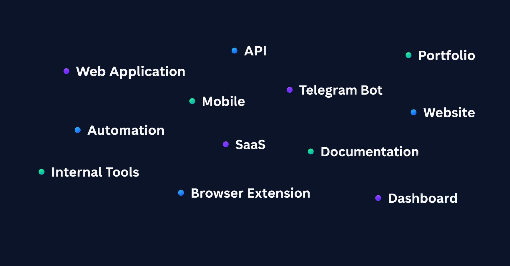

# Easy Starters

**Production-ready software foundations for web, API, mobile, browser extension, and documentation.**

[Website](https://fonijbuild.github.io/easy-starters/) · [FonijBuild](https://github.com/FonijBuild) · [Discussions](https://github.com/orgs/FonijBuild/discussions)

> “What do we build for, if not to lessen each other’s hardship?”

## The Philosophy

**Production-capable, not bloated.**  
Include what real projects need, not every possible feature.

**Architecture before dependencies.**  
Prefer clear boundaries and maintainability over more libraries.

**Start small, evolve when needed.**  
Use the simplest foundation that fits today.

**Boring defaults win.**  
Tooling should stay understandable, replaceable, and easy to maintain.

**AI-first by design.**  
Clear specs, architecture, and project rules help humans and agents work effectively.

## Starters

| Foundation            | Best for                                                          | Core stack                       | Repository                                                                                                                                                         |
| --------------------- | ----------------------------------------------------------------- | -------------------------------- | ------------------------------------------------------------------------------------------------------------------------------------------------------------------ |
| **React SPA**         | Dashboards, internal tools, client-side products                  | React · Vite · TypeScript        | [Repository](https://github.com/FonijBuild/easy-vite-react-spa-starter) · [Use template](https://github.com/FonijBuild/easy-vite-react-spa-starter/generate)       |
| **Next.js Web**       | Web apps, SaaS, portals, and SEO-sensitive experiences            | Next.js · React · TypeScript     | [Repository](https://github.com/FonijBuild/easy-nextjs-web-starter) · [Use template](https://github.com/FonijBuild/easy-nextjs-web-starter/generate)               |
| **Django API**        | Business APIs, admin workflows, multi-client backends             | Django · Python · PostgreSQL     | [Repository](https://github.com/FonijBuild/easy-django-api-starter) · [Use template](https://github.com/FonijBuild/easy-django-api-starter/generate)               |
| **Expo App**          | An iOS and Android application                                    | Expo · React Native · TypeScript | [Repository](https://github.com/FonijBuild/easy-expo-app-starter) · [Use template](https://github.com/FonijBuild/easy-expo-app-starter/generate)                   |
| **Browser Extension** | A Chrome, Firefox, or Edge extension                              | TypeScript · WebExtension APIs   | [Repository](https://github.com/FonijBuild/easy-browser-extension-starter) · [Use template](https://github.com/FonijBuild/easy-browser-extension-starter/generate) |
| **Python Service**    | Bots, workers, automations, integrations, and background services | Python                           | [Repository](https://github.com/FonijBuild/easy-python-service-starter) · [Use template](https://github.com/FonijBuild/easy-python-service-starter/generate)       |
| **Starlight Docs**    | Developer docs, knowledge bases, and product documentation        | Astro · Starlight · TypeScript   | [Repository](https://github.com/FonijBuild/easy-starlight-doc-starter) · [Use template](https://github.com/FonijBuild/easy-starlight-doc-starter/generate)         |

## Contributing

If you find a bug or want to propose an improvement to a specific foundation, open an issue in that starter's repository.

For ideas that affect the whole Easy Starters collection, use [Easy Starters Issues](https://github.com/FonijBuild/easy-starters/issues).

For broader product and architecture discussions, use [FonijBuild Discussions](https://github.com/orgs/FonijBuild/discussions).
